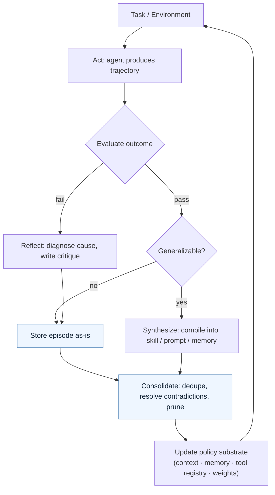

<div align="center">

# 🔁 Awesome Self-Improving Agents

**A curated map, framework registry, and benchmark suite for AI agents that actually get better over time.**

[](https://awesome.re)
[](https://opensource.org/licenses/MIT)
[](CONTRIBUTING.md)
[](https://github.com/travisim/awesome-self-improving-agents/actions/workflows/validate.yml)

[Definition](#-what-counts-as-self-improvement) • [The Loop](#-the-improvement-loop) • [Pillars](#-the-five-pillars) • [Frameworks](#-framework-registry) • [Papers](#-research-index) • [Benchmarks](#-benchmarks) • [Roadmap](#-roadmap--good-first-issues) • [Contributing](CONTRIBUTING.md)

</div>

---

## 📌 Why This Exists

Most "agents" in production are **stateless functions with a chat history**. Ask one to fix the same class of bug it fixed last Tuesday and it starts from zero — same wrong assumptions, same failed tool calls, same rediscovery cost.

Three bottlenecks keep agents from compounding:

1. **Amnesia** — context is discarded at session end, or reduced to dense retrieval over raw transcripts that happily returns superseded facts.
2. **No self-correction** — the agent retries the same failing action instead of diagnosing *why* it failed and changing strategy.
3. **No skill accumulation** — successful trajectories are thrown away instead of compiled into reusable, callable procedures.

**Memory is a subset of this problem.** Storing experience is table stakes; the hard part is *acting differently next time*. This repo is organized around that distinction: memory is Pillar 1 of 5, not the whole story.

---

## 🧭 What Counts as Self-Improvement

An agent self-improves when its **policy for future tasks changes as a result of its own experience**, without a human relabeling the data.

That definition has five axes. Most papers and frameworks differ mainly in *where* they sit on them:

| Axis | Question | Options |
| :--- | :--- | :--- |
| **Signal source** | Where does the feedback come from? | Environment/verifier · LLM self-critique · human · reward model |
| **Locus of update** | What actually changes? | Context window · external memory · prompt/program · tool library · model weights |
| **Persistence** | How long does the improvement last? | Single turn · session · cross-session · across model versions |
| **Supervision** | How much ground truth is needed? | Full labels · sparse tests · self-generated labels · none |
| **Verifiability** | Can improvement be *proven*? | Executable tests · rubric judge · human eval · none (⚠️) |

> ⚠️ Any claimed improvement without a verifier is a **vibe**, not a result. The benchmark section exists to make that distinction cheap to check.

---

## 🔄 The Improvement Loop



The loop is only closed if step **P** changes behavior on the *next* task. A retrieval system that returns the right memory but leaves the action distribution unchanged has closed nothing.

---

## 🏛️ The Five Pillars

### 1. Memory — *remembering* → [docs/memory-shapes.md](docs/memory-shapes.md)
Working, episodic, semantic (graph), and procedural memory; consolidation, contradiction resolution, and retrieval policy.
*Necessary but not sufficient. Memory that never changes a decision is a database with extra steps.*

### 2. Reflection — *diagnosing* → [docs/self-learning-mechanisms.md](docs/self-learning-mechanisms.md)
Reflexion-style verbal reinforcement, Self-Refine iteration, and tool-grounded critique (CRITIC). Turns a failure signal into a portable natural-language lesson.

### 3. Skill Synthesis — *compiling*
When a trajectory finally succeeds, abstract it into a typed, callable tool with a docstring and an embedding description, then register it in procedural memory. (Voyager, ExpeL, CREATOR, ToolLLM, Agent Workflow Memory.)

### 4. Self-Verification — *checking*
Test execution, unit tests, type checkers, formal verifiers, and LLM judges used as *gates* rather than vibes. Verifier quality upper-bounds improvement quality; a weak verifier rewards confident wrong answers.

### 5. Parameter-Level Learning — *internalizing*
When context and tools saturate, improvement has to land in weights: self-generated training data (STaR), self-play fine-tuning (SPIN), self-rewarding models, self-editing memory weights (SEAL), and open-ended search over agent code (ADAS, Gödel Agent, Darwin Gödel Machine).

👉 Full taxonomy and design trade-offs: **[docs/self-improvement-loop.md](docs/self-improvement-loop.md)**

---

## 🛠️ Framework Registry

Star counts are pulled from the GitHub API and will drift — treat them as a rough activity signal, not a benchmark.

### Memory & context substrates

| Project | Stars | Memory shape | Storage | Why it's here |
| :--- | ---: | :--- | :--- | :--- |
| [**Mem0**](https://github.com/mem0ai/mem0) | 69.5k | Personalized episodic + semantic | Hybrid vector + graph | Multi-tenant fact extraction with automatic add/update/delete of memories. |
| [**Cognee**](https://github.com/topoteretes/cognee) | 33.6k | GraphRAG + entity triples | Neo4j / LanceDB / NetworkX | Deterministic graph pipelines for repeatable recall. |
| [**Letta**](https://github.com/letta-ai/letta) (ex-MemGPT) | 25.5k | Hierarchical OS-style memory | Postgres / SQLite | Treats the context window as RAM and pages state to archival storage. |
| [**Zep**](https://github.com/getzep/zep) | 5.0k | Temporal knowledge graph | Graph + vector | Time-aware graph that resolves entity facts across long timelines. |
| [**HippoRAG**](https://github.com/OSU-NLP-Group/HippoRAG) | 4.1k | Hippocampal indexing graph | KG + Personalized PageRank | Multi-hop associative recall inspired by memory consolidation. |
| [**LangMem**](https://github.com/langchain-ai/langmem) | 1.8k | In-context + long-term episodic | LangGraph state | Memory SDK wired into stateful LangGraph agents. |

### Improvement loops, skill libraries & agent scaffolds

| Project | Stars | Improvement mechanism | Locus of update |
| :--- | ---: | :--- | :--- |
| [**OpenHands**](https://github.com/OpenHands/OpenHands) | 94.3k | Execution-feedback loop over real repos | Context + tools |
| [**DSPy**](https://github.com/stanfordnlp/dspy) | 39.2k | Compiles prompts/programs against a metric | Prompt/program |
| [**SWE-agent**](https://github.com/SWE-agent/SWE-agent) | 20.9k | ACI-tuned agent-computer interface | Tools + context |
| [**Voyager**](https://github.com/MineDojo/Voyager) | 7.3k | Automatic curriculum + growing skill library | Tool library |
| [**TextGrad**](https://github.com/zou-group/textgrad) | 3.8k | "Differentiation" via natural-language feedback | Prompt/program |
| [**ExpeL**](https://github.com/LeapLabTHU/ExpeL) | 0.3k | Cross-task experience extraction into insights | Context + memory |

---

## 📚 Research Index

Verified against the arXiv API. Grouped by **where the improvement lands**.

### Memory & retrieval

| Paper | Year | Contribution |
| :--- | ---: | :--- |
| [MemGPT](https://arxiv.org/abs/2310.08560) | 2023 | OS-style virtual context management with paging. |
| [Generative Agents](https://arxiv.org/abs/2304.03442) | 2023 | Memory stream + reflection + planning loop. |
| [Mem0](https://arxiv.org/abs/2504.19413) | 2025 | Scalable long-term memory with extraction/update pipeline. |
| [Zep](https://arxiv.org/abs/2501.13956) | 2025 | Temporal knowledge graph memory (Graphiti). |
| [HippoRAG](https://arxiv.org/abs/2405.14831) | 2024 | Neurobiologically inspired long-term memory via PPR. |
| [A-MEM](https://arxiv.org/abs/2502.12110) | 2025 | Zettelkasten-style agentic memory with link generation. |
| [GraphRAG](https://arxiv.org/abs/2404.16130) | 2024 | Query-focused summarization over extracted entity graphs. |

### Reflection & in-context learning

| Paper | Year | Contribution |
| :--- | ---: | :--- |
| [Reflexion](https://arxiv.org/abs/2303.11366) | 2023 | Verbal reinforcement: store self-critiques, retry with them. |
| [Self-Refine](https://arxiv.org/abs/2303.17651) | 2023 | Iterative self-feedback without extra training. |
| [CRITIC](https://arxiv.org/abs/2305.11738) | 2023 | Self-correction grounded in external tools. |
| [Agent Workflow Memory](https://arxiv.org/abs/2409.07429) | 2024 | Induces reusable workflows from past trajectories. |

### Skill acquisition & tool synthesis

| Paper | Year | Contribution |
| :--- | ---: | :--- |
| [Voyager](https://arxiv.org/abs/2305.16291) | 2023 | Open-ended embodied agent with a lifelong skill library. |
| [ExpeL](https://arxiv.org/abs/2308.10144) | 2023 | Experience-based learning by extracting cross-task insights. |
| [CREATOR](https://arxiv.org/abs/2305.14318) | 2023 | Tool creation separates abstract from concrete reasoning. |
| [ToolLLM](https://arxiv.org/abs/2307.16789) | 2023 | Masters 16k+ real-world APIs via tool-use trajectories. |

### Optimizing prompts & programs

| Paper | Year | Contribution |
| :--- | ---: | :--- |
| [DSPy](https://arxiv.org/abs/2310.03714) | 2023 | Compiles declarative LM pipelines against a metric. |
| [TextGrad](https://arxiv.org/abs/2406.07496) | 2024 | Backpropagates natural-language feedback through programs. |
| [OPRO](https://arxiv.org/abs/2309.03409) | 2023 | LLMs as optimizers over natural-language instructions. |
| [Promptbreeder](https://arxiv.org/abs/2309.16797) | 2023 | Self-referential prompt evolution. |
| [STOP](https://arxiv.org/abs/2310.02304) | 2023 | Recursively self-improving code generation. |

### Self-improving agents & open-ended search

| Paper | Year | Contribution |
| :--- | ---: | :--- |
| [Gödel Agent](https://arxiv.org/abs/2410.04444) | 2024 | Self-referential framework that rewrites its own logic. |
| [ADAS](https://arxiv.org/abs/2408.08435) | 2024 | Automated design/search over agentic systems. |
| [Darwin Gödel Machine](https://arxiv.org/abs/2505.22954) | 2025 | Open-ended evolution of self-modifying agents. |

### Parameter-level self-training

| Paper | Year | Contribution |
| :--- | ---: | :--- |
| [STaR](https://arxiv.org/abs/2203.14465) | 2022 | Bootstraps reasoning from the model's own correct solutions. |
| [Self-Rewarding LMs](https://arxiv.org/abs/2401.10020) | 2024 | Model generates and judges its own training signal. |
| [SPIN](https://arxiv.org/abs/2401.01335) | 2024 | Self-play fine-tuning converts weak models to strong. |
| [SEAL](https://arxiv.org/abs/2506.10943) | 2025 | Models generate their own finetuning data and update directives. |
| [Absolute Zero](https://arxiv.org/abs/2505.03335) | 2025 | Self-play reasoning with zero external data. |
| [Constitutional AI](https://arxiv.org/abs/2212.08073) | 2022 | Self-critique against a written constitution. |
| [AlphaZero](https://arxiv.org/abs/1712.01815) | 2017 | The canonical self-play improvement loop. |

---

## 📊 Benchmarks

Runnable suite in [`benchmarks/`](benchmarks/README.md). **Status is honest**: implemented vs. planned is marked explicitly.

| Metric | What it measures | Status |
| :--- | :--- | :--- |
| **COF** — Contradiction & Overwrite Fidelity | Does the agent answer with the *updated* fact, not the stale one, when a preference/endpoint changes mid-history? | ✅ Dataset + schema validation |
| **NIMS** — Needle in Multi-Turn Session | Can it recall a constraint injected 20/50/100 turns back through noise? | ✅ Dataset + schema validation |
| **CSST** — Cross-Session Skill Transfer | Does a skill taught in Session 1 actually execute in Session 2? | ✅ Dataset + schema validation |
| **VSCE** — Verbal Self-Correction Efficiency | Reflection iterations to convergence on a task with an executable verifier. | 🚧 Wanted — see [#7](https://github.com/travisim/awesome-self-improving-agents/issues) |
| **Adapter parity** | Same agent, swap memory backend, measure delta. | 🚧 Wanted |

```bash
git clone https://github.com/travisim/awesome-self-improving-agents
cd awesome-self-improving-agents
python3 benchmarks/runner/eval_memory.py --validate   # schema check
python3 benchmarks/runner/eval_memory.py --list       # what's in each dataset
```

The runner validates datasets and adapter interfaces. It does **not** invent scores — adapter execution produces numbers, and only if you wire one up.

---

## 🏆 Leaderboard — Community-Reported, Unverified

> ⚠️ **This table is not a measurement.** These are community-reported impressions collected from public discussion; no single harness produced them, prompts/versions differ, and none have been reproduced by this repo. They are kept as a *hypothesis list* to be replaced by real adapter runs. Treat every number as unverified. PRs that add a reproducible run (harness + config + logs) are the fastest way to improve this table.

| Model family | Working-memory retention | External-memory adherence | Self-correction | Commonly reported role |
| :--- | :---: | :---: | :---: | :--- |
| Claude Sonnet family | *reported high* | *reported high* | *reported low iteration count* | Orchestration + critique |
| Gemini Pro family | *reported high, large context* | *reported medium* | *reported medium* | Long-history synthesis |
| OpenAI o-series | *reported high* | *reported high* | *reported low iteration count* | Decomposition + verification |
| DeepSeek R/V families | *reported medium* | *reported medium* | *reported medium* | High-throughput workers |

Raw record with provenance fields: [`data/leaderboard.json`](data/leaderboard.json). Schema versioning and a `reproduced: true|false` flag are enforced there.

---

## 🗺️ Roadmap & Good First Issues

- [ ] Implement the VSCE dataset and scoring spec — [#7](https://github.com/travisim/awesome-self-improving-agents/issues)
- [ ] Write the Zep / Graphiti deep-dive and adapter — [#5](https://github.com/travisim/awesome-self-improving-agents/issues)
- [ ] Write the HippoRAG paper summary and adapter stub — [#6](https://github.com/travisim/awesome-self-improving-agents/issues)
- [ ] Adapter parity harness (swap backends behind one `MemoryAdapter` interface)
- [ ] Replace the community leaderboard with reproducible runs

See all open issues: [issues](https://github.com/travisim/awesome-self-improving-agents/issues)

---

## 🤝 Contributing

Add a framework, a paper, a benchmark scenario, or an adapter implementation — see [CONTRIBUTING.md](CONTRIBUTING.md). Every dataset and paper link is CI-validated.

---

## 📄 License

MIT License © 2026 [Travis Sim](https://github.com/travisim)
