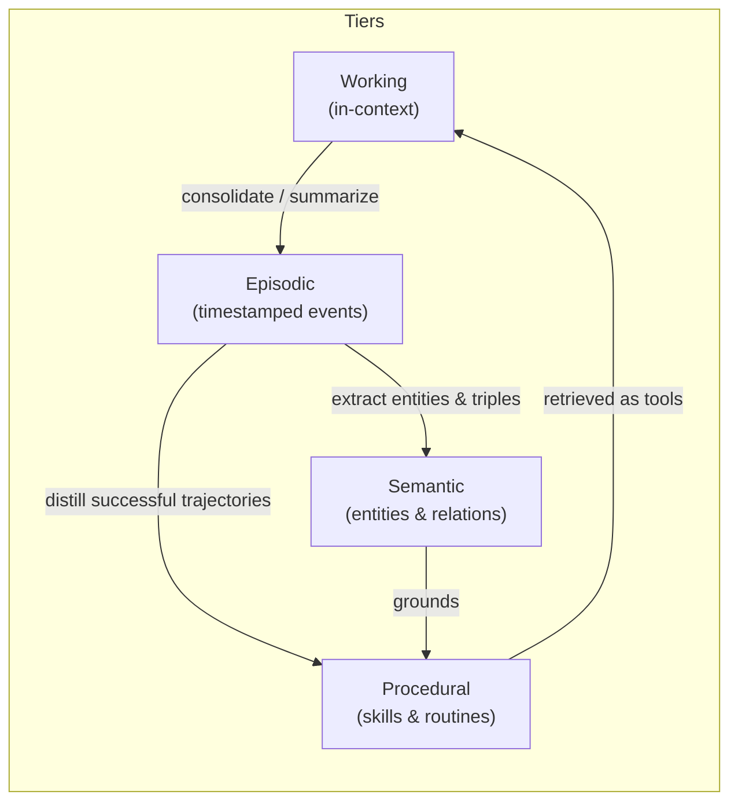

# Memory Shapes: The Substrate Layer

> **Position in this repo:** memory is **Pillar 1 of 5**. This document covers *where experience is stored*. What makes an agent self-improving is whether that storage changes future actions — see [self-improvement-loop.md](self-improvement-loop.md).

Agent memory is not one vector index. Production systems separate it into functional tiers with different write paths, query semantics, and failure modes.

---

## Overview

---

## 1. Working Memory

**What it is.** The active attention window: system prompt, recent turns, scratchpad, tool outputs, and reasoning traces currently in context.

**Characteristics.**
- Substrate: tokens in the KV cache.
- Latency: no retrieval hop — it is simply already there.
- Capacity: bounded by the model's context limit; effective capacity is smaller than the advertised limit.

**Failure modes.**
- *Context rot* — as the window fills, attention to early instructions weakens; models begin violating constraints stated at turn 1.
- *Distraction* — irrelevant retrieved content measurably hurts reasoning versus no retrieval at all.
- *Truncation* — naive windowing silently drops the constraint that mattered.

**Practices.**
- Keep the system prompt lean and put invariants at both the start and the end.
- Summarize deterministically at tier boundaries rather than letting the window overflow.
- Treat "more context" as a cost, not a free win.

---

## 2. Episodic Memory

**What it is.** Time-indexed records of what happened: sessions, tool calls, observations, outcomes.

**Characteristics.**
- Substrate: append-only logs (SQLite/Postgres) plus embeddings for retrieval.
- Query paradigm: semantic similarity, usually filtered by recency and/or importance.
- Typical implementations: Mem0, Letta archival blocks, Zep episodes, Generative Agents' memory stream.

**The core difficulty.** Pure cosine similarity has no notion of *supersession*. "User prefers AWS" (turn 5) and "User switched to GCP" (turn 80) are equally similar to "what cloud does the user use?" — and the earlier, wrong fact often wins because it appears in more chunks.

**What a serious episodic tier needs.**
1. **Provenance** — every record knows which session/turn produced it.
2. **Recency weighting** — explicit, not an accident of embedding geometry.
3. **Importance scoring** — not all turns deserve equal retention.
4. **Supersession links** — when a new fact contradicts an old one, link and demote the old one rather than deleting silently.
5. **Decay** — unreferenced, low-importance records should age out.

This is what the **COF** benchmark measures.

---

## 3. Semantic Memory

**What it is.** Facts and relations abstracted away from the episode that produced them, typically as triples `(subject, predicate, object)` or a property graph.

**Characteristics.**
- Substrate: Neo4j, Kùzu, NetworkX, LanceDB graph, or an in-process adjacency structure.
- Query paradigm: traversal, multi-hop expansion, Personalized PageRank, community summaries.
- Typical implementations: HippoRAG, Cognee, Zep/Graphiti, Microsoft GraphRAG.

**Why graphs help.**
- **Multi-hop** — "Alice works at X; X uses Y; does Alice's team depend on Y?" is a traversal, not a similarity lookup.
- **Surgical updates** — rewriting one edge invalidates the old relation without re-embedding a transcript.
- **Auditability** — you can show the exact path that produced an answer.

**Costs.**
- Extraction is lossy and error-prone; bad triples are worse than no triples.
- Schema drift and entity resolution (`travis`, `Travis Sim`, `user_501`) are ongoing maintenance.
- Graph construction latency makes it a poor fit for per-turn writes — batch extraction is the norm.

---

## 4. Procedural Memory

**What it is.** "How to do things": callable skills, workflow templates, tool schemas, compiled prompts.

**Characteristics.**
- Substrate: code files, an AST/skill registry, tool definitions, compiled DSPy programs.
- Mechanism: on success, distill the trajectory into a reusable artifact with a name, docstring, typed signature, and a description embedding for retrieval.
- Inspiration: Voyager's skill library, ExpeL's extracted insights, Agent Workflow Memory's induced workflows.

**Why this is the highest-leverage tier.**
- It is **inspectable** (you can read the code), **diffable** (you can review a change), **revocable** (delete the skill), and **portable** (works when you swap models).
- It moves improvement from "the model might remember" to "the system can execute."

**Requirements before trusting a synthesized skill.**
1. A verification gate — the tests it passed.
2. A scope — the conditions under which it applies.
3. A regression record — what else was evaluated when it was admitted.
4. An owner and a version.

---

## 5. Cross-Tier Mechanics

### Consolidation
Batch or background process that merges duplicates, resolves contradictions, summarizes episodes into semantic facts, and promotes repeated successes into skills. Analogous to sleep-phase consolidation.

### Retrieval policy
The join across tiers is where most quality is won or lost:
- Prefer *procedural* hits for "how do I" queries and *semantic* hits for "what is" queries.
- Apply recency+authority for facts that can change.
- Cap retrieved tokens; rank by expected utility, not similarity alone.

### Write policy
Uncontrolled writes are the most common self-inflicted wound: stores fill with low-value chunks that then pollute retrieval. Gate writes on novelty and reusability, not on "the turn happened."

---

## 6. Choosing a Tier (and Admitting You Need Fewer)

| Need | Start with | Graduate to |
| :--- | :--- | :--- |
| Conversation continuity | Summarized working memory | Episodic store with recency weighting |
| "What is true about this entity?" | A structured profile row | Semantic graph with supersession |
| Repeated multi-step tasks | Prompt template | Skill library with verification gate |
| Cross-tenant personalization | Per-user episodic namespace | Hybrid episodic + semantic |

Start at the lowest rung that solves the measured problem. Each tier adds write-path complexity, failure modes, and cost.

---

## References

- Packer et al., *MemGPT: Towards LLMs as Operating Systems* — [arXiv:2310.08560](https://arxiv.org/abs/2310.08560)
- Park et al., *Generative Agents: Interactive Simulacra of Human Behavior* — [arXiv:2304.03442](https://arxiv.org/abs/2304.03442)
- Chhikara et al., *Mem0* — [arXiv:2504.19413](https://arxiv.org/abs/2504.19413)
- Rasmussen et al., *Zep: A Temporal Knowledge Graph Architecture for Agent Memory* — [arXiv:2501.13956](https://arxiv.org/abs/2501.13956)
- Gutiérrez et al., *HippoRAG* — [arXiv:2405.14831](https://arxiv.org/abs/2405.14831)
- Xu et al., *A-MEM: Agentic Memory for LLM Agents* — [arXiv:2502.12110](https://arxiv.org/abs/2502.12110)
- Edge et al., *From Local to Global: A Graph RAG Approach* — [arXiv:2404.16130](https://arxiv.org/abs/2404.16130)
- Wang et al., *Agent Workflow Memory* — [arXiv:2409.07429](https://arxiv.org/abs/2409.07429)
